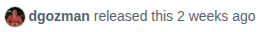

We recorded each task in W8 DOM-diff Bench three times, and each run twice over: once as screenshots, once as W8 DOM-diff Optimized states. This post opens one pair, task_08 in run_1, and reads what each record kept.

<!-- truncate -->

*Updated November 4, 2026 for the three-run release. The first version of this post read Task 19 from the first release.*

## The task

Task 08 sends the agent to the Playwright repository on GitHub. It asks for the newest stable release: the tag, the publication date, and three changes from the notes, with one change checked against the docs. This is the row from the published task set:

```json
{
  "task_id": "browser_task_008",
  "task_name": "software release research",
  "category": "linked-page research",
  "instruction": "Go to the GitHub repository for Microsoft Playwright at https://github.com/microsoft/playwright. Open the Releases page and identify the newest non-preview release. Report its release tag, publication date, and three changes from the release notes. Verify one of those changes using the official Playwright documentation.",
  "start_url": "https://github.com/microsoft/playwright",
  "stopping_condition": "Stop after the release metadata, three release-note changes, and one documentation verification have been recorded.",
  "constraints": ["Do not sign in.", "Do not create issues, comments, pull requests, or file changes."]
}
```

## Two records of the same step

The agent opened the releases list, then clicked v1.64.1. State 2 is the release page.

### The screenshot run



The frame shows the byline as GitHub renders it: `dgozman released this 2 weeks ago`. The exact date sits in a tooltip, outside the frame.

### The W8 run

The same step in `dom_model2.txt`. The timestamp is in the page's markup, so the record holds it:

```text
- v1.64.1
- dgozman released this 14 Oct 11:51 · 1 commit to release-1.64 since this release v1.64.1 cfe490d
- dgozman released this 14 Oct 11:51
- 14 Oct 11:51
```

One step earlier, on the releases list, `dom_model1.txt` keeps the year as well: `v1.64.1 Latest Oct 14, 2026`.

The record keeps the interactive elements, each with a stable id the agent can act on. Even the reaction buttons carry a timestamp:

```text
[26864] link "Latest"
[26874] button "Compare" control_state=expanded=false
[27017] button "thumbs up (11): dgozman, 09:18PM on October 13" control_state=pressed=false,disabled=true
```

## What each record kept

| Criterion | Screenshot run | W8 run |
| --- | --- | --- |
| Release tag | `v1.64.1` | `v1.64.1` |
| Commit | `cfe490d` | `cfe490d` |
| Release date | "2 weeks ago" | `14 Oct 11:51` |

Both records answer two of the three. On the third, the screenshot holds a relative age and W8 holds the exact time. That is why the [saved audit](https://huggingface.co/datasets/WootzappLab/browser-agent-tasks/blob/main/evaluations/run_1/task_08/batch_01/evidence_audit.json) marks criterion C2 of this task as a screenshot evidence loss. Both verifiers read their own evidence correctly; the screenshot verifier had less to read.

:::note
Across the three recorded runs, screenshots lacked required evidence on 61 of 619 matched criteria per run on average (9.85%). W8 records lacked it on 13 (2.10%). The counts, the method, and the recordings are on the [benchmark page](/research/w8-domdiff-bench).
:::

> We introduce `w8-domdiff-bench`, a recording and audit framework that compares screenshots and compact DOM-derived text from the same browser execution. The task, executed actions, final answer, and verification rubric are held fixed within each pair.
>
> — from the abstract of the paper

## Read the records yourself

The task set and all three runs of every task are on Hugging Face.

```python
from datasets import load_dataset

tasks = load_dataset("WootzappLab/browser-agent-tasks", split="test")
task = next(t for t in tasks if t["task_id"] == "browser_task_008")
print(task["instruction"])
```

- [Screenshot run of task_08, run_1](https://huggingface.co/datasets/WootzappLab/browser-agent-tasks/tree/main/trajectories/run_1/data-ss/task_08)
- [W8 run of task_08, run_1](https://huggingface.co/datasets/WootzappLab/browser-agent-tasks/tree/main/trajectories/run_1/data-dom/task_08)
- [Saved audit for task_08, run_1](https://huggingface.co/datasets/WootzappLab/browser-agent-tasks/blob/main/evaluations/run_1/task_08/batch_01/evidence_audit.json)
- [Paper](https://github.com/wootzapp/w8-domdiff-bench/blob/w8-reproducible/README.md)
